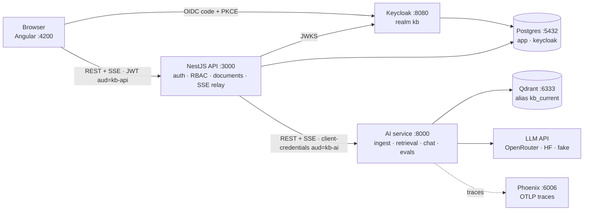

# FS100 — the FULL FULL stack

**A RAG and agent assistant for the "Dev of the future"** — an engineer fluent across DB · Dev · Cloud ·
DevOps · MLOps · AI integration · Security · Architecture · SRE. Upload documents tagged by domain, ask
questions, get **streamed answers with citations** — with every retrieval change **measured** by an eval
run and every request **traceable** from retrieval to prompt to model.

The project is built in six phases; the full plan for Phase 1 lives in **[plan.md](plan.md)**.

> **Status:** Phase 1 · **M1.2 ingestion, retrieval, eval** — on top of the M1.1 auth skeleton, the AI
> service ingests PDF/Markdown/TXT into Qdrant and searches it with domain filters; a 60-question golden
> set measures retrieval (`pnpm eval:retrieval`). No chat and no upload UI yet — see [roadmap](#roadmap).

---

## Stack

| Layer | Technology |
|---|---|
| Web | Angular 22 (standalone, signals, zoneless) · Bootstrap 5.3 via SCSS · Vitest · angular-eslint |
| Product API / BFF | NestJS 12 (ESM) on Node 24 · Vitest + supertest · oxlint |
| AI service | FastAPI on Python 3.13 (uv) · pydantic-settings · ruff · pyright (strict) · pytest |
| Identity | Keycloak 26.7 — realm `kb`, OIDC Authorization Code + PKCE, roles `viewer` < `editor` < `admin` |
| Data | Postgres 17 (`app`, `keycloak`) · Qdrant 1.18 (vectors) |
| LLM & tracing | OpenRouter / Hugging Face router via one OpenAI-compatible adapter (M1.3) · Arize Phoenix (OpenTelemetry) |
| Tooling | pnpm 12 workspaces + catalogs · uv · Docker Compose · GitHub Actions |

## Architecture (Phase 1 target)



Only the web app and the NestJS API are browser-facing; all AI code lives in the Python service
([ADR-0002](docs/adr/0002-ai-layer-in-python.md)). Details: [plan.md §5](plan.md#5-architecture-phase-1).

## Quickstart

Needs Node 24, pnpm (via Corepack), uv and Docker — see the **[installation guide](docs/setup/installation.md)**.

```bash
corepack enable pnpm
pnpm install && uv sync --directory apps/ai-service
cp .env.example .env
pnpm stack:up        # Postgres, Qdrant, Keycloak, Phoenix (waits until healthy)
pnpm dev             # web :4200 · api :3000 · ai-service :8000, hot reload
```

Open http://localhost:4200. Everything else — URLs, seed users, checks, troubleshooting — is in the
**[startup guide](docs/setup/startup.md)**.

## Commands

| Command | What it does |
|---|---|
| `pnpm dev [web\|api\|ai …]` | Start the apps natively with hot reload (loads `.env`) |
| `pnpm stack:up` / `stack:down` | Start / stop the local infra (data kept in volumes) |
| `pnpm stack:ps` / `stack:logs [service]` | Status / logs of the infra |
| `pnpm stack:reset` | Stop the infra and **delete** its volumes |
| `pnpm lint` | angular-eslint · oxlint · prettier check · ruff · pyright |
| `pnpm test` | Vitest (web, api) · pytest (ai-service) |
| `pnpm build` | Production builds of web and api |
| `pnpm format` | Auto-format (prettier + ruff) |
| `pnpm eval:retrieval` | Retrieval eval against the golden set, in-memory Qdrant ([evals/README.md](evals/README.md)) |
| `pnpm contracts:generate` | OpenAPI types + SSE JSON Schemas — *placeholder until M1.4* |

## Repository layout

```
apps/
  web/            Angular 22 frontend            → apps/web/README.md
  api/            NestJS 12 product API / BFF    → apps/api/README.md
  ai-service/     FastAPI AI service (uv)         → apps/ai-service/README.md
infra/
  compose/        docker-compose.yml (Mode A infra; app containers join in M1.6)
  keycloak/       realm-kb.json (roles, clients, dev seed users)
  postgres/       init.sql (databases keycloak + app)
data/sample-docs/ Demo + eval corpus with domain tags (domains.json, ATTRIBUTION.md)
evals/            Golden datasets, eval docs; runs/ is git-ignored
docs/
  setup/          installation.md · startup.md
  adr/            Architecture Decision Records
scripts/          dev.mjs · stack.mjs · not-yet.mjs
.github/workflows/ci.yml
plan.md           Phase 1 plan (decisions, contracts, milestones)
```

Folders from plan.md §6 that belong to later milestones (`packages/contracts`, `e2e/`) are created when
their milestone starts.

## Documentation

- [plan.md](plan.md) — Phase 1 plan: scope, decisions D1–D26, contracts, milestones, risks
- [Installation guide](docs/setup/installation.md) — toolchain for macOS (Apple Silicon), Linux, Windows/WSL2
- [Startup guide](docs/setup/startup.md) — first start, daily routine, URLs, seed users, troubleshooting
- [ADRs](docs/adr/README.md) — 0001 monorepo & pnpm · 0002 AI layer in Python · 0003 in-process embeddings ·
  0004 embedding model, chunking and score threshold
- [Evals](evals/README.md) — golden set, metrics, how to run and version

## Roadmap

| Phase | Theme |
|---|---|
| **1** | Foundation + RAG slice + eval + tracing — *in progress: M1.0 – M1.2 done* |
| 2 | Agent loop from scratch, agentic RAG, MCP server + client, domain tools, agent evals |
| 3 | Hybrid search, reranking, code-aware RAG, guardrails, routing + semantic cache, memory |
| 4 | Kubernetes: Helm, k3d, GitOps-ready manifests |
| 5 | Azure: Terraform, ACR, AKS / Container Apps, Key Vault, OIDC from GitHub |
| 6 | MLOps & local models: fine-tuning with MLflow, Ollama/MLX, system card |

Phase 1 milestones: M1.0 repo & tooling → M1.1 infra + auth walking skeleton → M1.2 ingestion, retrieval,
eval → M1.3 grounded chat → M1.4 documents + relays → M1.5 UI → M1.6 containers, CI, e2e · M1.7 Azure
readiness spike ([plan.md §8](plan.md#8-milestones-and-tasks)).

## Naming

The project is called **FS100**. The plan's working title `kb-agent` survives in technical identifiers
(Keycloak realm `kb`, clients `kb-web` / `kb-api` / `kb-ai`, Qdrant alias `kb_current`) so that plan.md and
the contracts stay aligned.

## Contributing

Trunk-based on `main`, [Conventional Commits](https://www.conventionalcommits.org/), `pnpm lint && pnpm test`
before pushing. Only public or self-written documents go into the corpus (plan.md D25); never commit
secrets — `.env` is git-ignored, `.env.example` holds dev-only placeholders.

## License

[MIT](LICENSE)
