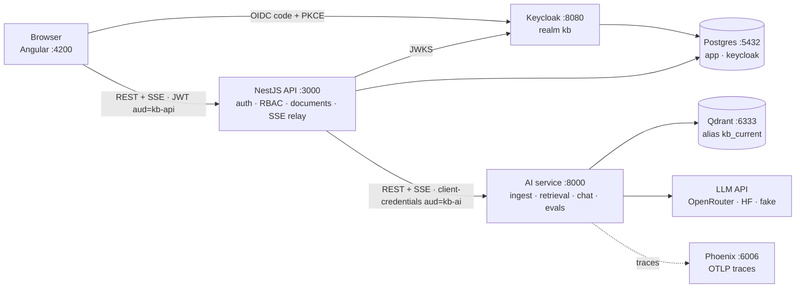

# FS100 — the FULL FULL stack

**A RAG and agent assistant for the "Dev of the future"** — an engineer fluent across DB · Dev · Cloud ·
DevOps · MLOps · AI integration · Security · Architecture · SRE. Upload documents tagged by domain, ask
questions, get **streamed answers with citations** — with every retrieval change **measured** by an eval
run and every request **traceable** from retrieval to prompt to model.

The project is built in six phases; the full plan for Phase 1 lives in **[plan.md](plan.md)**.

> **Status:** Phase 2 · **M2.4 own MCP server & token exchange** — Phase 1 is in place: the AI service ingests
> PDF/Markdown/TXT into Qdrant, searches it with domain filters (measured by a 60-question golden set,
> `pnpm eval:retrieval`) and streams cited answers over SSE; the NestJS API handles uploads (RBAC, dedupe,
> background ingest) and relays chat and search; the Angular UI has upload, chat with clickable citations and a
> retrieval inspector; everything also runs as containers, with contracts, e2e and the retrieval eval in CI.
> New in Phase 2: an own agent loop (`POST /v1/agent`) that searches the knowledge base as a tool, streams its
> tool activity as SSE v2 events and stops at hard limits (steps, time, tokens, cost); stored conversations in the
> API with a tool-activity timeline, model picker (`config/models.yaml`), feedback and today's usage in the UI;
> sub-topics from `config/taxonomy.yaml` on documents, relabelled without re-embedding; write tools stop for the
> user's approval (HMAC-signed action, at-most-once state machine) and every tool call lands in an append-only audit
> log with an admin page; the agent reaches the knowledge base through the service's own MCP server (`/mcp`:
> search, documents, sources, `ingest_url` behind approval), and user identity travels as Keycloak-exchanged tokens on
> every hop — see [roadmap](#roadmap).

---

## Stack

| Layer | Technology |
|---|---|
| Web | Angular 22 (standalone, signals, zoneless) · Bootstrap 5.3 via SCSS · Vitest · angular-eslint |
| Product API / BFF | NestJS 12 (ESM) on Node 24 · Vitest + supertest · oxlint |
| AI service | FastAPI on Python 3.13 (uv) · pydantic-settings · ruff · pyright (strict) · pytest |
| Identity | Keycloak 26.8 — realm `kb`, OIDC Authorization Code + PKCE, roles `viewer` < `editor` < `admin` |
| Data | Postgres 17 (`app`, `keycloak`) · Qdrant 1.19 (vectors) |
| LLM & tracing | OpenRouter / Hugging Face router via one OpenAI-compatible adapter · Arize Phoenix (OpenTelemetry) |
| Tooling | pnpm 12 workspaces + catalogs · uv · Docker Compose · GitHub Actions |

## Architecture (Phase 1 target)



Only the web app and the NestJS API are browser-facing; all AI code lives in the Python service
([ADR-0002](docs/adr/0002-ai-layer-in-python.md)). Ingest and chat flows step by step:
**[docs/architecture.md](docs/architecture.md)**.

## Retrieval quality

Every retrieval change is judged by `pnpm eval:retrieval` (60 questions, DE + EN, 10 unanswerable — see
[evals/README.md](evals/README.md)); CI posts the same table on pull requests that touch the AI service.
The benchmark that picked the embedding model ([ADR-0004](docs/adr/0004-embedding-model-chunking-threshold.md),
chunks 1000/150):

| Model | hit@1 | hit@5 | MRR@10 | nDCG@10 | p50 ms |
|---|---|---|---|---|---|
| `intfloat/multilingual-e5-small` | 0.56 | 0.86 | 0.69 | 0.72 | 7 |
| `intfloat/multilingual-e5-base` | 0.64 | 0.86 | 0.73 | 0.75 | 22 |
| `intfloat/multilingual-e5-large` | 0.68 | 0.94 | 0.80 | 0.83 | 71 |
| **`BAAI/bge-m3`** (default) | **0.76** | **0.98** | **0.84** | **0.86** | 59 |

Each chat request is traced in Phoenix (http://localhost:6006): `chat → embed → search → llm` with the
prompt, token counts and latency; the chat UI links every answer to its trace.

## Quickstart

**Just run it** — Docker and Node 24 only, everything in containers (Mode B):

```bash
git clone https://github.com/davidkutt/FS100.git && cd FS100
corepack enable pnpm
cp .env.example .env    # either set LLM_API_KEY (OpenRouter key with a credit limit) + LLM_MODEL,
                        # or set LLM_PROVIDER=fake for free, canned answers
pnpm stack:up:full      # builds and starts everything; the first start downloads the ≈ 2.3 GB embedding model
```

Open http://localhost:4200, log in as `bob` / `bob` (editor) and upload files from `data/sample-docs/`
with the domains from its `domains.json`. Phoenix traces: http://localhost:6006.

**Develop** — Node 24, pnpm (via Corepack), uv and Docker, see the
**[installation guide](docs/setup/installation.md)**; infra in Docker, apps native with hot reload (Mode A):

```bash
corepack enable pnpm
pnpm install && uv sync --directory apps/ai-service
cp .env.example .env
pnpm stack:up        # Postgres, Qdrant, Keycloak, Phoenix (waits until healthy)
pnpm dev             # web :4200 · api :3000 · ai-service :8000, hot reload
```

Open http://localhost:4200. Everything else — URLs, seed users, checks, troubleshooting — is in the
**[startup guide](docs/setup/startup.md)**.

## Commands

| Command | What it does |
|---|---|
| `pnpm dev [web\|api\|ai …]` | Start the apps natively with hot reload (loads `.env`) |
| `pnpm stack:up` / `stack:down` | Start / stop the local infra (data kept in volumes) |
| `pnpm stack:up:full` | Infra **and** the apps as containers (Mode B), rebuilt when changed |
| `pnpm stack:ps` / `stack:logs [service]` | Status / logs of the infra |
| `pnpm stack:reset` | Stop the infra and **delete** its volumes |
| `pnpm lint` | angular-eslint · oxlint · prettier check · ruff · pyright |
| `pnpm test` | Vitest (web, api) · pytest (ai-service) |
| `pnpm build` | Production builds of web and api |
| `pnpm format` | Auto-format (prettier + ruff) |
| `pnpm e2e` | Playwright smoke against http://localhost:4200 (login → upload → ask → citation) |
| `pnpm eval:retrieval` | Retrieval eval against the golden set, in-memory Qdrant ([evals/README.md](evals/README.md)) |
| `pnpm contracts:generate` | Regenerate `packages/contracts` (OpenAPI of both services incl. SSE event schemas, TS types); commit the result |

## Repository layout

```
apps/
  web/            Angular 22 frontend            → apps/web/README.md
  api/            NestJS 12 product API / BFF    → apps/api/README.md
  ai-service/     FastAPI AI service (uv)         → apps/ai-service/README.md
                  each with a Dockerfile (build context: repo root, see .dockerignore)
packages/
  contracts/      Generated OpenAPI documents + TS types of api and ai-service (pnpm contracts:generate)
config/           models.yaml (model registry) · taxonomy.yaml (domains, sub-topics); baked into the images
infra/
  compose/        docker-compose.yml (infra; `--profile full` adds the three apps)
  keycloak/       realm-kb.json (roles, clients, dev seed users)
  postgres/       init.sql (databases keycloak + app)
data/sample-docs/ Demo + eval corpus with domain tags (domains.json, ATTRIBUTION.md)
evals/            Golden datasets, eval docs; runs/ is git-ignored
e2e/              Playwright smoke test (pnpm e2e)
docs/
  architecture.md Components, ingest and chat flows, runtime modes
  setup/          installation.md · startup.md
  adr/            Architecture Decision Records
  security/       red-teaming.md (playbook for attacking your own deployment)
scripts/          dev.mjs · stack.mjs
.github/          workflows: ci · e2e · eval · docker (GHCR) · dependabot.yml
plan.md           Phase 1 plan (decisions, contracts, milestones)
```

## Documentation

- [plan.md](plan.md) — Phase 1 plan: scope, decisions D1–D26, contracts, milestones, risks
- [plan-phase-2.md](plan-phase-2.md) — Phase 2 plan: agent, MCP, approvals; decisions D27–D49, milestones M2.0–M2.8
- [Architecture](docs/architecture.md) — components, ingest and chat flows, Mode A vs. Mode B
- [Installation guide](docs/setup/installation.md) — toolchain for macOS (Apple Silicon), Linux, Windows/WSL2
- [Startup guide](docs/setup/startup.md) — first start, daily routine, URLs, seed users, troubleshooting
- [ADRs](docs/adr/README.md) — 0001 monorepo & pnpm · 0002 AI layer in Python · 0003 in-process embeddings ·
  0004 embedding model, chunking and score threshold · 0005 LLM access and model choice
- [Evals](evals/README.md) — golden set, metrics, how to run and version
- [Red teaming](docs/security/red-teaming.md) — threat model, test catalogue, grading, process

## Roadmap

| Phase | Theme |
|---|---|
| 1 | Foundation + RAG slice + eval + tracing — *M1.0 – M1.6 done; M1.7 Azure spike postponed (local only for now)* |
| **2** | Agent loop from scratch, agentic RAG, MCP server + client, domain tools, agent evals — *in progress: M2.0 – M2.5 done* |
| 3 | Hybrid search, reranking, code-aware RAG, guardrails, routing + semantic cache, memory |
| 4 | Kubernetes: Helm, k3d, GitOps-ready manifests |
| 5 | Azure: Terraform, ACR, AKS / Container Apps, Key Vault, OIDC from GitHub |
| 6 | MLOps & local models: fine-tuning with MLflow, Ollama/MLX, system card |

Phase 1 milestones: M1.0 repo & tooling → M1.1 infra + auth walking skeleton → M1.2 ingestion, retrieval,
eval → M1.3 grounded chat → M1.4 documents + relays → M1.5 UI → M1.6 containers, CI, e2e · M1.7 Azure
readiness spike ([plan.md §8](plan.md#8-milestones-and-tasks)).

## Naming

The project is called **FS100**. The plan's working title `kb-agent` survives in technical identifiers
(Keycloak realm `kb`, clients `kb-web` / `kb-api` / `kb-ai`, Qdrant alias `kb_current`) so that plan.md and
the contracts stay aligned.

## Contributing

Trunk-based on `main`, [Conventional Commits](https://www.conventionalcommits.org/), `pnpm lint && pnpm test`
before pushing. Only public or self-written documents go into the corpus (plan.md D25); never commit
secrets — `.env` is git-ignored, `.env.example` holds dev-only placeholders.

## License

[MIT](LICENSE)
