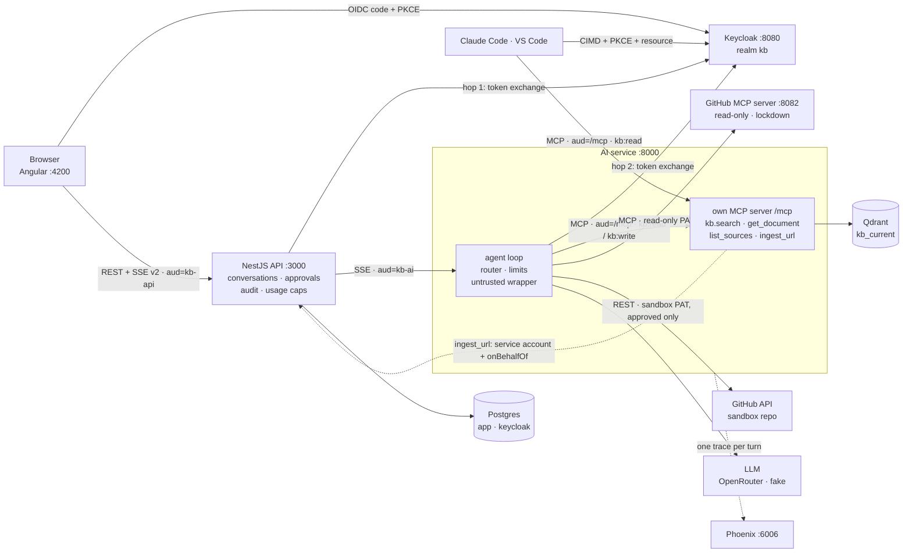

# FS100 — the FULL FULL stack

**A RAG and agent assistant for the "Dev of the future"** — an engineer fluent across DB · Dev · Cloud ·
DevOps · MLOps · AI integration · Security · Architecture · SRE. Upload documents tagged by domain, ask
questions, get **streamed answers with citations** — with every retrieval change **measured** by an eval
run and every request **traceable** from retrieval to prompt to model.

**Phase 2: the assistant is an agent.** It decides whether and where to search, reads CI runs, issues
and code through the official **GitHub MCP server**, reaches its own knowledge base through **its own MCP
server**, and **asks before it writes** — an issue in a sandbox repo or a document from a URL runs only
after you approve the exact arguments, exactly once, with an audit entry. Identity travels as
**Keycloak-exchanged tokens** on every internal hop, every turn is **one Phoenix trace** across the MCP hop, every
prompt is a **versioned file** whose version and hash land on messages, traces and eval runs, and every
user has a **daily cost cap**. Agent behaviour is measured too: task success, tool selection, cost and
latency on fixture MCP servers, plus a red-team seed set.

The project is built in six phases: [plan.md](plan.md) (Phase 1, done except the postponed Azure spike)
and [plan-phase-2.md](plan-phase-2.md) (Phase 2, M2.0 – M2.7 done; M2.8 code-complete).

---

## Stack

| Layer | Technology |
|---|---|
| Web | Angular 22 (standalone, signals, zoneless) · Bootstrap 5.3 via SCSS · Vitest · angular-eslint |
| Product API / BFF | NestJS 12 (ESM) on Node 24 · Vitest + supertest · oxlint |
| AI service | FastAPI on Python 3.13 (uv) · pydantic-settings · ruff · pyright (strict) · pytest |
| Identity | Keycloak 26.8 — realm `kb`, OIDC Authorization Code + PKCE, roles `viewer` < `editor` < `admin` |
| Data | Postgres 17 (`app`, `keycloak`) · Qdrant 1.19 (vectors) |
| LLM & tracing | OpenRouter / Hugging Face router via one OpenAI-compatible adapter · Arize Phoenix (OpenTelemetry) |
| Agent & tools | Own loop (no framework) · MCP Python SDK v2 (own server + client) · GitHub MCP server v2.0.2 |
| Tooling | pnpm 12 workspaces + catalogs · uv · Docker Compose · GitHub Actions |

## Architecture



A turn: the API checks the user's role and daily cap, exchanges their token for `aud=kb-ai` and relays
the agent's SSE v2 events (`route`, `step`, `tool_call`, `tool_result`, `sources`, `token`,
`approval_required`, `done`), storing each into the conversation, the audit log and the usage table. The
AI service exchanges the token again for its own MCP server, so the knowledge-base tools see the user,
not a service. A write call ends the turn with an HMAC-signed action; the API keeps it, shows an approval
card and resumes the turn once the user decides ([ADR-0008](docs/adr/0008-run-state-and-approvals.md)).
Only the web app and the API are browser-facing; all AI code lives in the Python service
([ADR-0002](docs/adr/0002-ai-layer-in-python.md)). Flows step by step: [docs/architecture.md](docs/architecture.md)
(Phase 1) and [plan-phase-2.md §5](plan-phase-2.md#5-architecture-phase-2).

## Retrieval quality

Every retrieval change is judged by `pnpm eval:retrieval` (60 questions, DE + EN, 10 unanswerable — see
[evals/README.md](evals/README.md)); CI posts the same table on pull requests that touch the AI service and
fails them when hit@5 or nDCG@10 drops more than 0.02 below the baseline below.
The benchmark that picked the embedding model ([ADR-0004](docs/adr/0004-embedding-model-chunking-threshold.md),
chunks 1000/150):

| Model | hit@1 | hit@5 | MRR@10 | nDCG@10 | p50 ms |
|---|---|---|---|---|---|
| `intfloat/multilingual-e5-small` | 0.56 | 0.86 | 0.69 | 0.72 | 7 |
| `intfloat/multilingual-e5-base` | 0.64 | 0.86 | 0.73 | 0.75 | 22 |
| `intfloat/multilingual-e5-large` | 0.68 | 0.94 | 0.80 | 0.83 | 71 |
| **`BAAI/bge-m3`** (default) | **0.76** | **0.98** | **0.84** | **0.86** | 59 |

Each chat request is traced in Phoenix (http://localhost:6006): `chat → embed → search → llm` with the
prompt, token counts and latency; the chat UI links every answer to its trace.

## Quickstart

**Just run it** — Docker and Node 24 only, everything in containers (Mode B):

```bash
git clone https://github.com/davidkutt/FS100.git && cd FS100
corepack enable pnpm
cp .env.example .env    # either set LLM_API_KEY (OpenRouter key with a credit limit) + LLM_MODEL,
                        # or set LLM_PROVIDER=fake for free, canned answers
pnpm stack:up:full      # builds and starts everything; the first start downloads the ≈ 2.3 GB embedding model
```

Open http://localhost:4200, log in as `bob` / `bob` (editor) and upload files from `data/sample-docs/`
with the domains from its `domains.json`. Phoenix traces: http://localhost:6006.

**Develop** — Node 24, pnpm (via Corepack), uv and Docker, see the
**[installation guide](docs/setup/installation.md)**; infra in Docker, apps native with hot reload (Mode A):

```bash
corepack enable pnpm
pnpm install && uv sync --directory apps/ai-service
cp .env.example .env
pnpm stack:up        # Postgres, Qdrant, Keycloak, Phoenix (waits until healthy)
pnpm dev             # web :4200 · api :3000 · ai-service :8000, hot reload
```

Open http://localhost:4200. Everything else — URLs, seed users, checks, troubleshooting — is in the
**[startup guide](docs/setup/startup.md)**.

## Demo (Phase 2)

The acceptance demo of [plan-phase-2.md §1](plan-phase-2.md#1-goal-and-demo-script), from a fresh clone
after the [Quickstart](#quickstart). Steps 3–6 need a real model (`LLM_API_KEY`, `LLM_MODEL` in `.env`);
steps 3–4 also need `GITHUB_REPO`, `GITHUB_SANDBOX_REPO` in `.env` and two fine-grained PATs in
`.env.local` (read-only on the repo, issues write on a sandbox repo only — see `.env.example`).

1. `pnpm stack:up` (infra incl. the GitHub MCP container) and `pnpm dev` — or `pnpm stack:up:full`.
2. Log in at http://localhost:4200 as `bob` / `bob` (editor), upload `data/sample-docs/` under
   **Documents** with the domains from `domains.json`, open **Chat** and pick a model.
3. Ask *"Why did the last CI run on main fail, and do we have a runbook for it?"* — the timeline shows the
   read-only `github.*` calls and `kb.search_knowledge_base`; the answer links the run and cites `[n]`.
4. Ask *"Open an issue for this in the sandbox repo."* — an approval card shows repo, title and body;
   **Approve** creates exactly one issue (deciding again returns 409), **Reject** lets the agent go on
   without acting. Both land in **Audit log** (as `alice`).
5. Ask *"Which ADRs do we have, and why does the AI layer live in Python?"* — `kb.list_sources` on the
   architecture domain, then a filtered search; the answer cites ADR-0002.
6. Ask a German question the documents answer, then an unanswerable one — the second abstains and is
   stored with `answerStatus: abstained` and its top score (the gap signal).
7. Press **Stop** mid-answer — the run is cancelled and stored with `stopReason: cancelled`.
8. Log in as `carol` (viewer): the write tools are never offered to the model and the harness denies
   them by role; the sidebar shows today's cost against her daily cap (0.20 USD), and once it is reached
   every turn answers `429`. As `alice`, **Usage** lists cost per user and day.
9. Open Phoenix (http://localhost:6006; every answer links its trace): `agent.run` → `llm` / `tool`
   spans, including the own MCP server's spans, with prompt version, prompt hash and model.
10. `pnpm eval:agent`, `pnpm eval:redteam`, `pnpm eval:routing` — reports in `evals/runs/`
    ([evals/README.md](evals/README.md)); `pnpm eval:retrieval` is a blocking CI check.
11. `claude mcp add --transport http fs100-kb http://localhost:8000/mcp`, then `/mcp` → *Authenticate* in
    Claude Code: log in as `carol` in Keycloak and ask it to search the knowledge base — it calls
    `search_knowledge_base`; `ingest_url` is refused ([startup guide](docs/setup/startup.md#use-the-knowledge-base-from-claude-code--vs-code),
    also VS Code; experimental Keycloak features, [ADR-0014](docs/adr/0014-external-mcp-clients-cimd.md)).

## Commands

| Command | What it does |
|---|---|
| `pnpm dev [web\|api\|ai …]` | Start the apps natively with hot reload (loads `.env`) |
| `pnpm stack:up` / `stack:down` | Start / stop the local infra (data kept in volumes) |
| `pnpm stack:up:full` | Infra **and** the apps as containers (Mode B), rebuilt when changed |
| `pnpm stack:ps` / `stack:logs [service]` | Status / logs of the infra |
| `pnpm stack:reset` | Stop the infra and **delete** its volumes |
| `pnpm lint` | angular-eslint · oxlint · prettier check · ruff · pyright |
| `pnpm test` | Vitest (web, api) · pytest (ai-service) |
| `pnpm build` | Production builds of web and api |
| `pnpm format` | Auto-format (prettier + ruff) |
| `pnpm e2e` | Playwright smoke against http://localhost:4200 with `LLM_PROVIDER=fake`: login → upload → ask → citation; approval reject → approve |
| `pnpm eval:retrieval` | Retrieval eval against the golden set, in-memory Qdrant ([evals/README.md](evals/README.md)) |
| `pnpm eval:agent` | Agent tasks against the corpus and fixture MCP servers; uses the LLM in `.env` (3 repeats, 2 USD cap) |
| `pnpm eval:redteam` | Red-team seed set (injections, exfiltration, goal hijack), same setup as `eval:agent` |
| `pnpm eval:routing` | Router accuracy on `routing_v1`: embedding vs LLM classifier |
| `pnpm contracts:generate` | Regenerate `packages/contracts` (OpenAPI of both services incl. SSE event schemas, TS types); commit the result |

## Repository layout

```
apps/
  web/            Angular 22 frontend            → apps/web/README.md
  api/            NestJS 12 product API / BFF    → apps/api/README.md
  ai-service/     FastAPI AI service (uv)         → apps/ai-service/README.md
                  prompts in src/ai_service/prompts/ (id@version front matter, ADR-0013)
                  each with a Dockerfile (build context: repo root, see .dockerignore)
packages/
  contracts/      Generated OpenAPI documents + TS types of api and ai-service (pnpm contracts:generate)
config/           models.yaml (model registry) · taxonomy.yaml (domains, sub-topics) · mcp_servers.yaml
                  (external MCP servers, allow-lists); baked into the images
infra/
  compose/        docker-compose.yml (infra; `--profile full` adds the three apps)
  keycloak/       realm-kb.json (roles, clients, dev seed users)
  postgres/       init.sql (databases keycloak + app)
data/sample-docs/ Demo + eval corpus with domain tags (domains.json, ATTRIBUTION.md)
evals/            Datasets, fixture MCP servers + scenarios, eval docs; runs/ is git-ignored
e2e/              Playwright smoke test (pnpm e2e)
docs/
  architecture.md Components, ingest and chat flows, runtime modes
  setup/          installation.md · startup.md
  adr/            Architecture Decision Records
  system-card.md  Models, data, safeguards, eval baselines, known limitations
  security/       red-teaming.md (playbook for attacking your own deployment)
scripts/          dev.mjs · stack.mjs
.github/          workflows: ci · e2e · eval · docker (GHCR) · dependabot.yml
plan.md           Phase 1 plan (decisions, contracts, milestones)
plan-phase-2.md   Phase 2 plan (agent, MCP, approvals)
```

## Documentation

- [plan.md](plan.md) — Phase 1 plan: scope, decisions D1–D26, contracts, milestones, risks
- [plan-phase-2.md](plan-phase-2.md) — Phase 2 plan: agent, MCP, approvals; decisions D27–D49, milestones M2.0–M2.8
- [Architecture](docs/architecture.md) — components, ingest and chat flows, Mode A vs. Mode B
- [Installation guide](docs/setup/installation.md) — toolchain for macOS (Apple Silicon), Linux, Windows/WSL2
- [Startup guide](docs/setup/startup.md) — first start, daily routine, URLs, seed users, troubleshooting
- [System card](docs/system-card.md) — models, data, safeguards, eval baselines, known limitations
- [Evals](evals/README.md) — retrieval, agent, red-team and routing sets, metrics, fixtures, how to run
- [Red teaming](docs/security/red-teaming.md) — threat model, test catalogue, grading, process

**Architecture Decision Records** ([index and how to write one](docs/adr/README.md)):

| ADR | Decision |
|---|---|
| [0001](docs/adr/0001-monorepo-and-pnpm.md) | Monorepo with pnpm workspaces, uv for Python |
| [0002](docs/adr/0002-ai-layer-in-python.md) | All AI code lives in a Python service; NestJS is the product API |
| [0003](docs/adr/0003-embeddings-in-process.md) | Embeddings computed in-process with fastembed |
| [0004](docs/adr/0004-embedding-model-chunking-threshold.md) | Embedding model `bge-m3`, chunking 1000/150, score threshold 0.55 |
| [0005](docs/adr/0005-llm-access-and-model.md) | One OpenAI-compatible LLM adapter; dev and demo model |
| 0006 | Azure region and quota — postponed with M1.7 |
| [0007](docs/adr/0007-agent-harness-and-limits.md) | Own agent harness with hard limits; dev model for agent mode |
| [0008](docs/adr/0008-run-state-and-approvals.md) | Stateless agent turns; approvals as HMAC-signed actions, at-most-once |
| [0009](docs/adr/0009-token-exchange-internal-hops.md) | Keycloak standard token exchange on the internal hops |
| [0010](docs/adr/0010-own-mcp-server-sdk-v2.md) | Own MCP server and client on Python SDK v2 |
| [0011](docs/adr/0011-plain-vs-agentic-rag.md) | Agentic RAG for conversations; plain RAG stays the measured baseline |
| [0012](docs/adr/0012-embedding-vs-llm-router.md) | Embedding router by default; the LLM classifier stays opt-in |
| [0013](docs/adr/0013-prompt-versioning.md) | Prompts as versioned files, with a content hash on every record |
| [0014](docs/adr/0014-external-mcp-clients-cimd.md) | External MCP clients via Keycloak CIMD; its experimental features always on |

## Roadmap

| Phase | Theme |
|---|---|
| 1 | Foundation + RAG slice + eval + tracing — *M1.0 – M1.6 done; M1.7 Azure spike postponed (local only for now)* |
| **2** | Agent loop from scratch, agentic RAG, MCP server + client, domain tools, agent evals — *M2.0 – M2.7 done; M2.8 external MCP clients code-complete* |
| 3 | Hybrid search, reranking, code-aware RAG, guardrails, routing + semantic cache, memory |
| 4 | Kubernetes: Helm, k3d, GitOps-ready manifests |
| 5 | Azure: Terraform, ACR, AKS / Container Apps, Key Vault, OIDC from GitHub |
| 6 | MLOps & local models: fine-tuning with MLflow, Ollama/MLX, system card |

Phase 1 milestones: M1.0 repo & tooling → M1.1 infra + auth walking skeleton → M1.2 ingestion, retrieval,
eval → M1.3 grounded chat → M1.4 documents + relays → M1.5 UI → M1.6 containers, CI, e2e · M1.7 Azure
readiness spike ([plan.md §8](plan.md#8-milestones-and-tasks)).

## Naming

The project is called **FS100**. The plan's working title `kb-agent` survives in technical identifiers
(Keycloak realm `kb`, clients `kb-web` / `kb-api` / `kb-ai`, Qdrant alias `kb_current`) so that plan.md and
the contracts stay aligned.

## Contributing

Trunk-based on `main`, [Conventional Commits](https://www.conventionalcommits.org/), `pnpm lint && pnpm test`
before pushing. Only public or self-written documents go into the corpus (plan.md D25); never commit
secrets — `.env` is git-ignored, `.env.example` holds dev-only placeholders.

## License

[MIT](LICENSE)
