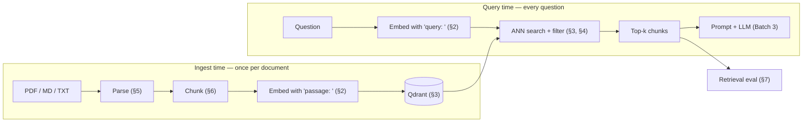

# Batch 1 — Retrieval Foundations

> **Project:** kb-agent · **Study-list topics:** #1 RAG · #4 Text embeddings · #6 Vector databases & ANN · #7 Metadata filtering · #2 Document parsing · #3 Chunking · #17 Retrieval evaluation
> **Plan link:** M1.2 (weeks 3–4, ~18 h) · decisions D8, D9, D10, D22, D23
> **Effort:** ~90 min reading + ~30 min self-check
> **Written:** 2026-10-13 · library facts checked against fastembed 0.9.0, qdrant-client 1.19.1, pypdf 5.9.0, markdown-it-py 4.2.0

---

## Why this batch first

- **M1.2 is the largest milestone (~18 h) and starts in week 3.** You have about two weeks of lead time while you do M1.0/M1.1 (repo, auth). Those milestones aren't on the AI study list.
- **Two "never cut" items live here: the golden set and the eval harness.** The golden set must be written *before any tuning*, so you need the evaluation theory before you touch embedding models.
- **Every Phase 3 technique modifies this pipeline.** Hybrid search, reranking, query rewriting and contextual retrieval are all judged by the metrics in §7. Understand the baseline first.
- **Deliberately not in this batch:** #5 model benchmarking, #11 thresholds, #8 idempotent ingestion, #9 alias re-indexing and #18 tracing. They build on everything here and form Batch 2.

**How to work through it:**
1. Read a section.
2. Answer its self-check *without looking back*, and write the answers down; they make good raw material for ADRs.
3. Do the optional "Try it" once the stack runs.
4. Update `../../../ai-studies/DONE.md`: `delivered` → `reviewed` once you can answer the self-check, and `applied` once the topic is in code.

---

## 0. The map



Both halves must use the **same model, the same preprocessing and the matching prefixes**. A mismatch never raises an error; it silently lowers scores. Most RAG bugs in this batch are of that silent kind, which is why §7 exists.

---

## 1. RAG — the mental model (#1)

**In one sentence:** RAG is an open-book exam. Instead of hoping the model memorised your docs, you look up the relevant pages at question time and put them in front of it.

### Why not just …?

| Option | Good at | Bad at |
|---|---|---|
| The model's own knowledge | General knowledge, reasoning | Your private or new docs; frozen at training cutoff; no source to cite |
| Fine-tuning the LLM | Style, format, behaviour | Reliably injecting facts; every update means retraining; no citations; no per-user permissions |
| Pasting everything into a long context | Small corpora, one-off analysis | Cost and latency grow with corpus size on *every* request; models use information buried in the middle of long contexts less reliably ("lost in the middle"); no permission filtering |
| **RAG** | Updatable knowledge, citations, per-user filtering, cheap per query | Answer quality is capped by retrieval quality; more moving parts |

### Two pipelines

- **Ingest (offline):** parse → chunk → embed → store. Runs once per document version, and the cost is paid at upload.
- **Query (online):** embed question → search → assemble context → generate. Runs on every request, inside a latency budget.

### Where RAG fails — the taxonomy you'll debug with all project long

| Stage | Symptom | Example | Where you see it |
|---|---|---|---|
| Ingestion | Text missing or mangled | Table flattened; scanned PDF has no text | Inspector shows a garbage chunk |
| Retrieval — recall | Right chunk not in top-k at all | Paraphrased or cross-language question | Eval: hit@5 = 0 for that item |
| Retrieval — ranking | Right chunk found, but too low | At rank 8 while `top_k=5` | Eval: hit@10 > hit@5, low MRR |
| Context assembly | Retrieved, but dropped or diluted | Token budget trims it | Phoenix: chunk not in the prompt |
| Generation | In the prompt, but ignored or misread | Hallucinated CLI flag | Phoenix: chunk *is* in the prompt, answer still wrong |

**The key rule: generation cannot fix a retrieval miss.** If the right chunk isn't in the prompt, the best LLM in the world either refuses (good) or guesses (bad). That's why the plan measures retrieval alone in Phase 1 and generation only in Phase 3. You debug the pipeline from left to right.

### In your plan

- `/v1/search` is retrieval alone (used by the inspector and the eval). `/v1/chat` is retrieval plus generation. Keeping search separately callable is what makes the taxonomy above debuggable.
- The retrieval inspector (demo step 5) is the *manual* view of retrieval; the eval harness is the *automatic* view.

### Self-check

1. An answer is wrong but cites `[2]`. Name three stages that could be at fault, and say how the inspector and Phoenix tell them apart.
2. Why is fine-tuning the LLM a poor way to teach it your runbooks?
3. Why does the plan evaluate retrieval before generation?

---

## 2. Text embeddings (#4)

**In one sentence:** An embedding model is a neural network that turns a text into a fixed-length list of numbers, so that texts with similar meaning get nearby vectors.

### What the model actually learned

- **Training is contrastive.** The model sees (query, relevant passage) pairs. It pulls each pair together and pushes the other passages in the batch away (in-batch negatives, InfoNCE loss). You'll do this yourself in Phase 6 (#55).
- **"Similar" means whatever the training pairs said was similar.** Retrieval-trained models (E5, BGE) learned "this passage answers this query", which differs from "these two texts are paraphrases". That's why model choice must be measured on *your* data (Batch 2, #5).

### Bi-encoder vs cross-encoder

| | Bi-encoder (E5, BGE) | Cross-encoder (rerankers) |
|---|---|---|
| Input | Query and passage encoded **separately** | (query, passage) read **together** |
| Precompute passages? | Yes, at ingest | No, one model run per pair at query time |
| Speed at 1M chunks | Milliseconds (vector comparison) | Impossible; only for a shortlist |
| Accuracy | Good | Clearly better |
| In your project | Phase 1 retrieval | Phase 3 reranking (#22) |

Mental model: a bi-encoder sorts the library by topic, and a cross-encoder actually reads the 30 candidate pages.

### How a text becomes one vector

1. Tokenise the text.
2. The transformer outputs one vector per token.
3. **Pooling** compresses these into one vector. E5 takes the mean of the token vectors; BGE takes the `[CLS]` token.
4. The result is L2-normalised.

fastembed does all of this, but for some of your models you'll have to *configure* the pooling yourself (see the box below).

### Similarity math

- cosine(a, b) = a·b / (‖a‖·‖b‖), a value in [−1, 1].
- After L2 normalisation (‖a‖ = ‖b‖ = 1), cosine equals the dot product, and squared Euclidean distance is ‖a − b‖² = 2 − 2·cos. So **cosine, dot product and Euclidean distance produce the same ranking** on normalised vectors. Qdrant's `Cosine` distance normalises vectors on upload and then computes dot products.
- **Scores are only comparable within one model.** E5 was trained with a very low temperature, so its cosine scores cluster in a narrow high band; the model card says roughly 0.7–1.0. An irrelevant chunk can easily score 0.78. A threshold of 0.8 means something completely different for bge-m3, so thresholds must be calibrated per model (Batch 2, #11).

### Size, memory, speed

| Model | Dim | Params (≈) | Max tokens | Prefixes |
|---|---|---|---|---|
| multilingual-e5-small | 384 | 118 M | 512 | `query: ` / `passage: ` |
| multilingual-e5-base | 768 | 278 M | 512 | `query: ` / `passage: ` |
| multilingual-e5-large | 1024 | 560 M | 512 | `query: ` / `passage: ` |
| bge-m3 | 1024 | 568 M | 8192 | none |

- **Vector memory = N × dim × 4 bytes** (float32). At 100 k chunks that's about 154 MB at 384 dims, 307 MB at 768 dims and 410 MB at 1024 dims, plus the index graph. Your Phase 1 corpus of a few thousand chunks needs about 10 MB.
- **On your M1, the *model* dominates RAM and latency, not the vectors.** CPU embedding time grows roughly with parameter count, so e5-large is several times slower per chunk than e5-small.

### Token limits — silent truncation

- **E5 reads at most 512 tokens.** Anything beyond is cut off silently: no error, and the tail of the chunk simply doesn't influence the vector.
- **1000 characters is roughly 200–350 tokens.** English prose is about 4 characters per token. German compounds, code, YAML and CLI flags split into more pieces.
- **1000-char chunks are safe; a 2000-char benchmark variant may not be.** Code-heavy runbooks can push past 512 tokens, which would penalise that variant unfairly. Count tokens once with the model's own tokenizer, e.g. `tokenizers.Tokenizer.from_pretrained("intfloat/multilingual-e5-base")`, and record max and p95 in ADR-0004.

### Asymmetric prefixes (E5)

- **E5 was trained with `query: ` before queries and `passage: ` before passages.** Its model card says to always add them, because results degrade without them. For symmetric tasks, such as comparing two *questions* in a semantic cache later (#50), use `query: ` on both sides.
- **bge-m3 uses no prefixes.** So prefixes are a **property of the model**, not of your pipeline. Keep them in a per-model profile; otherwise your benchmark silently feeds E5 prefixes to bge-m3.
- **Verified in fastembed 0.9.0:** `query_embed()` and `passage_embed()` do **not** add E5 prefixes; they call `embed()` with your text unchanged. Your `Embedder` must add them.

```python
from dataclasses import dataclass
from fastembed import TextEmbedding

@dataclass(frozen=True)
class ModelProfile:
    name: str
    dim: int
    query_prefix: str
    passage_prefix: str
    max_tokens: int

PROFILES = {
    "intfloat/multilingual-e5-base": ModelProfile("intfloat/multilingual-e5-base", 768, "query: ", "passage: ", 512),
    "BAAI/bge-m3": ModelProfile("BAAI/bge-m3", 1024, "", "", 8192),
}

class Embedder:
    def __init__(self, profile: ModelProfile, cache_dir: str | None = None):
        self.profile = profile
        self._model = TextEmbedding(model_name=profile.name, cache_dir=cache_dir)

    def embed_passages(self, texts: list[str]) -> list[list[float]]:
        prefixed = [self.profile.passage_prefix + t for t in texts]
        return [v.tolist() for v in self._model.embed(prefixed)]

    def embed_query(self, text: str) -> list[float]:
        return next(iter(self._model.embed([self.profile.query_prefix + text]))).tolist()
```

**The test that matters:** swap `_model` for a fake that records its inputs, and assert that `embed_query("x")` sent exactly `"query: x"`. This one assertion catches both a *missing* and a *doubled* prefix.

> ### ⚠ fastembed reality check — affects D9 and ADR-0004
>
> Checked against fastembed 0.9.0's model list:
>
> | Candidate | Built into fastembed? | How to use it |
> |---|---|---|
> | multilingual-e5-large | ✅ `intfloat/multilingual-e5-large` | Use directly |
> | **multilingual-e5-base (your default)** | ❌ | Register with `TextEmbedding.add_custom_model(...)`; the HF repo ships `onnx/model.onnx` |
> | multilingual-e5-small | ❌ | Same as e5-base |
> | bge-m3 | ❌ | Custom model with CLS pooling, `onnx/model.onnx` plus `onnx/model.onnx_data`. **Dense only:** this route does not give you bge-m3's sparse weights |
>
> ```python
> from fastembed import TextEmbedding
> from fastembed.common.model_description import ModelSource, PoolingType
>
> TextEmbedding.add_custom_model(
>     model="intfloat/multilingual-e5-base",
>     pooling=PoolingType.MEAN, normalization=True,
>     sources=ModelSource(hf="intfloat/multilingual-e5-base"),
>     dim=768, model_file="onnx/model.onnx",
> )
> TextEmbedding.add_custom_model(
>     model="BAAI/bge-m3",
>     pooling=PoolingType.CLS, normalization=True,
>     sources=ModelSource(hf="BAAI/bge-m3"),
>     dim=1024, model_file="onnx/model.onnx",
>     additional_files=["onnx/model.onnx_data"],
> )
> ```
>
> **What was and wasn't verified:** registration works and the ONNX files exist in the repos. Not verified is that the downloaded custom models reproduce the reference embeddings, because the download couldn't run here. Add a **golden-vector test**: embed three sentences once with `sentence-transformers` (with the same prefixes), store the vectors in a fixture, and assert cosine ≥ 0.999 against fastembed's output.
>
> **Consequences for the plan:**
> - The e5-base default still works; it just needs the registration spike plus the golden-vector test (~30–60 min).
> - D9's rationale "bge-m3 gives dense + sparse from one model" doesn't hold *via fastembed*. Your Phase 3 hybrid search options are:
>   - fastembed's `Qdrant/bm25`, which ships German and English Snowball stemmers (one language per model instance);
>   - running bge-m3 through its PyTorch library (FlagEmbedding) to get sparse weights, which is heavier on the M1.
>
>   bge-m3 stays a valid *dense* benchmark candidate. Record the decision in ADR-0004.

### Multilingual: one shared space

- **Cross-language retrieval works without translation.** Multilingual models are trained so that "Deployment zurückrollen" and "roll back a deployment" land near each other.
- **But equally relevant same-language matches usually score higher than cross-language ones** (language bias). A German question may prefer a mediocre German chunk over the perfect English one. That's exactly why §7 breaks metrics down per language and the golden set includes DE→EN items.

### Pitfalls

- **Mixing models in one collection.** Vectors from different models, or even different versions of one model, are not comparable. This is why the collection name contains the model slug (D10).
- **Prefix mismatch.** `passage: ` at ingest but no `query: ` at search time degrades results silently.
- **Truncation.** Long chunks silently lose their tail.
- **Comparing absolute scores across models.**

### Try it

Embed "Wie rolle ich ein Deployment zurück?" against three passages: a relevant English one, a relevant German one and an irrelevant one. Do it with and without prefixes and print the 3×2 score table. You'll see how narrow E5's score band is, and where language bias shows up.

### Self-check

1. Why can a bi-encoder search a million chunks in milliseconds while a cross-encoder can't?
2. Why do cosine, dot product and Euclidean distance give the same ranking on normalised vectors?
3. An unrelated chunk scores 0.79 with e5-base. Is the model broken?
4. Where should prefixes live in your code, and which single test catches both a missing and a doubled prefix?
5. What happens to a 900-token chunk embedded with E5?

---

## 3. Vector databases & approximate nearest-neighbour search (#6)

**In one sentence:** A vector database answers "give me the k stored vectors most similar to this one", fast, with JSON metadata attached to every vector.

### Exact vs approximate

- **Exact (brute-force) kNN** compares the query against every vector, i.e. N × dim multiply-adds. For 5,000 chunks × 768 dims that's about 3.8 M operations, well under a millisecond on a CPU. **At Phase 1 scale, brute force is perfectly fine.**
- **ANN (approximate nearest neighbour)** trades a little accuracy (recall) for sub-linear search time once you have millions of vectors.

### HNSW in five minutes

```
layer 2:  A ─────────────────── F                     few nodes, long jumps ("highways")
layer 1:  A ────── C ────── F ────── H
layer 0:  A─B─C─D─E─F─G─H─I─J                         every node, short links ("local streets")
          the query enters at the top, descends greedily, refines on layer 0
```

**HNSW (Hierarchical Navigable Small World)** stores vectors as nodes in a graph, each connected to its near neighbours. Upper layers are sparse and allow long jumps; layer 0 contains every node.

**Search path:**
1. Start at the entry point on the top layer.
2. Greedily hop to whichever neighbour is closer to the query, until no neighbour improves.
3. Drop a layer and repeat.
4. On layer 0, keep a candidate list of size `ef` and return the best k.

**Knobs (Qdrant names):**
- `m` — links per node (default 16). More links give better recall but use more memory.
- `ef_construct` — candidate list size while building (default 100). A higher value builds a better graph but indexes more slowly.
- `hnsw_ef` — candidate list size at query time. This is the recall/latency dial you can turn per query.

**Why "approximate":** greedy search can get stuck in a local optimum and miss a true neighbour. ANN recall is usually high with defaults, but you **measure** it rather than assume it.

### What this means for you right now

- **Your Phase 1 search is probably exact.** Qdrant doesn't build an HNSW index for small segments; below the optimizer's indexing threshold (a few thousand vectors at your dimensions) it does a full scan. Check with `GET /collections/{collection_name}`: an `indexed_vectors_count` of 0 means exact search.
- **So ANN errors won't explain your Phase 1 misses** — model, chunking and parsing will. Once the corpus grows (Phase 3+), rerun the golden set with `SearchParams(exact=True)` and compare. That gives you ANN recall as one more metric in the harness.
- **`QdrantClient(":memory:")` always brute-forces and ignores payload indexes** (verified; it warns about both). It's fine for unit tests, but anything touching filters or indexes needs the real server via testcontainers, as D20 plans.

### Qdrant data model

- **Collection:** a set of points that share one vector configuration (names, size, distance).
- **Point:** an `id` (unsigned int or UUID) plus one or more **named vectors** plus a **payload** (JSON).
- **Named vectors:** you have `dense` now and will want a sparse vector for hybrid search later. Treat the vector configuration as fixed at creation: adding a vector type means a new collection and an alias switch (Batch 2, #9). Your alias makes that a switch, not a migration.
- **Payload:** you filter on it (§4) and return it with results. `text`, `page` and `heading` become the citation.

```python
from qdrant_client import QdrantClient, models

client = QdrantClient(url="http://localhost:6333")
collection = "kb__e5-base__768"                      # physical name: model slug + dim (D10)

client.create_collection(
    collection_name=collection,
    vectors_config={"dense": models.VectorParams(size=768, distance=models.Distance.COSINE)},
)
# create payload indexes right away, before uploading data (see §4)
for field in ("doc_id", "owner_id", "domains"):
    client.create_payload_index(collection, field_name=field,
                                field_schema=models.PayloadSchemaType.KEYWORD)
# (PayloadSchemaType.UUID also exists and is more compact for UUID fields; KEYWORD is fine at your scale)

client.update_collection_aliases(change_aliases_operations=[
    models.CreateAliasOperation(create_alias=models.CreateAlias(
        collection_name=collection, alias_name="kb_current"))
])

hits = client.query_points(
    collection_name="kb_current",            # the ALIAS: app code never names a physical collection
    query=embedder.embed_query("Wie rolle ich ein Deployment zurück?"),
    using="dense",
    limit=5,
    with_payload=True,
).points
for h in hits:
    print(round(h.score, 3), h.payload["filename"], h.payload["heading"])
```

### Pitfalls

- **Physical collection names in app code.** Only the collection manager should know them; everything else uses the alias.
- **Wrong distance.** It's fixed per collection; use `Cosine` for E5 and BGE.
- **Dimension mismatch.** This one fails loudly on upsert, which is good.
- **Green unit tests on `:memory:`** while server behaviour (indexes, HNSW, filter planning) differs.

### Self-check

1. Describe HNSW's search path from the entry point to the result in three sentences.
2. ANN recall is too low at query time. Which parameter do you raise, and what does it cost?
3. Why is your Phase 1 search probably exact, and how do you verify it?
4. Why does app code query the alias rather than the collection?

---

## 4. Metadata filtering (#7)

**In one sentence:** Find the most similar chunks, but only among those whose payload matches a condition.

### Filter language (Qdrant)

- **Clauses:** `must` (AND), `should` (OR: at least one), `must_not` (NOT). They nest.
- **Conditions:** `MatchValue` (equals), `MatchAny` (in list), `MatchExcept`, `Range`, `IsEmpty`, `IsNull`, `HasId`, and more.
- **Arrays:** a condition on an array field is true if **any element** matches.

| Intent | Filter (`models.` prefix omitted) |
|---|---|
| Tagged `devops` | `Filter(must=[FieldCondition(key="domains", match=MatchValue(value="devops"))])` |
| `devops` OR `sre` | `Filter(must=[FieldCondition(key="domains", match=MatchAny(any=["devops", "sre"]))])` |
| `devops` AND `security` | Two `FieldCondition`s in `must` |
| Not from document X | `Filter(must_not=[FieldCondition(key="doc_id", match=MatchValue(value=X))])` |
| Untagged chunks | `Filter(must=[IsEmptyCondition(is_empty=PayloadField(key="domains"))])` |

The filter goes into `query_points(..., query_filter=...)`.

### Why filtering plus ANN is hard

| Strategy | How | Failure mode |
|---|---|---|
| Post-filter | ANN top-k first, then drop non-matching hits | If 2 % of points match, the top 10 may contain **zero** matches, so you get empty results although matches exist |
| Pre-filter | Find all matching points, then brute-force them | Exact, but slow when the filter matches most of the collection |
| **Filter during traversal (Qdrant)** | The HNSW walk only accepts matching nodes, and extra graph links per indexed payload value keep filtered subsets connected | Needs payload indexes |

On top of that, Qdrant's **query planner** uses the payload index to estimate how many points match. With few matches it scores them directly from the payload index, which is exact. With many matches it runs filtered HNSW.

**That's why D10's payload indexes matter.** Without an index the planner can't estimate cardinality. Qdrant recommends creating payload indexes right after creating the collection, so the HNSW build can include the filter-aware links.

### Two kinds of filters — never confuse them

| | Convenience filter (Phase 1: `domains`) | Security filter (Phase 3: ACL, #47) |
|---|---|---|
| Who sets it | The user (UI multi-select) | The server, from token claims |
| If it's wrong | The user misses results: a **recall** problem | A **data leak** |
| Built from | Request body | Verified JWT (`groups`, `sub`), **never** the request body |
| How it's combined | Optional | Always present, AND-ed with everything else |

Keep these as separate code paths from day one. Phase 3 then adds the ACL clause in exactly one place.

### Filters cost recall

A hard filter makes everything outside it invisible. If a document is tagged `devops` but should be `sre`, a filtered search can't find it, however good the embedding is.

**Mitigations:**
- Tag generously (several tags per document).
- Make "no filter" the default in chat.
- In the eval, run the per-domain items **with and without** the domain filter. If filtered is worse, your tags are wrong.

### Pitfalls

- **Keyword indexes are exact and case-sensitive.** `DevOps` ≠ `devops`, so validate tags against the taxonomy at upload (already in M1.4).
- **An empty `domains` array never matches `MatchAny`.** Untagged docs vanish under any filter.

### Self-check

1. Why can post-filtering return zero results even though matching chunks exist?
2. What does a payload index give the query planner?
3. Where must the Phase 3 ACL filter values come from, and why not from the request body?
4. How would your eval reveal a mis-tagged document?

---

## 5. Document parsing (#2)

**In one sentence:** Parsing turns files into clean text blocks with location metadata (page, heading path), and its errors are the ones no later step can undo.

### PDFs are not text documents

A PDF stores *drawing instructions*, such as "glyph R at (72, 540) in font F2". There are no paragraphs, no headings and often no spaces; the extractor reconstructs text from glyph positions. Typical damage:

| Problem | Effect on retrieval | Phase 1 mitigation |
|---|---|---|
| Header, footer and page number repeated on every page | Noise in every chunk ("Page 3 of 12" ends up in vectors) | Strip lines that repeat on most pages |
| Hyphenation at line ends (`Deploy-\nment`) | The word is split, so the embedding and later keyword search miss it | Join `-\n` followed by a lowercase letter |
| Ligatures (`fi`, `fl`), odd Unicode | "config" ≠ "config" | NFKC normalisation; note that it also turns `²` into `2` |
| Multi-column layouts | Interleaved reading order | Visible in the inspector; Docling in P3 |
| Tables | Flattened into word soup | Accept for now; Docling in P3 |
| Scanned PDFs | No text layer, so pages come out empty | Detect ~0 characters per page and mark the doc `failed` with a clear error, not `ready` with 0 chunks |
| Invisible text (white on white, tiny fonts) | Extracted like normal text: an **indirect prompt-injection vector** | Batch 4 (#20); sources are marked untrusted in the prompt (M1.3) |

**pypdf notes:**
- `PdfReader(f).pages[i].extract_text()` works per page, which gives you the page mapping for free. Remember that index 0 is page 1.
- `extract_text(extraction_mode="layout")` tries to preserve the visual layout. It's sometimes better for tables and columns and worse for prose, so test it on your fixtures.
- PyMuPDF is AGPL, so it's correctly excluded in D8.

### Markdown: structure for free — if you parse it properly

- **Headings give you the heading path** (`Runbook: Rollback › Helm › Verify`) that makes citations and eval labels precise.
- **Don't detect headings with a regex like `^#+ `.** Your runbooks contain bash blocks where `# install deps` is a comment, not a heading. A real parser such as markdown-it-py emits `heading_open` tokens with levels and line ranges, and code blocks as separate `fence` tokens. Verified: a `# comment` inside a fenced block is *not* reported as a heading.
- **Front matter** (YAML between `---` lines): strip it, or better, read `title` and `domains` from it.
- **Images are invisible to text RAG.** Multimodal ingestion is #54, in Phase 6.

### TXT

There's no structure, only paragraphs. The main risk is **encoding**: a Latin-1 file read as UTF-8 turns "zurück" into "zurück". Decode strictly and fail loudly, or use an explicit fallback; never silently replace characters.

### Design: one intermediate representation

```python
from dataclasses import dataclass

@dataclass
class Block:
    text: str
    page: int | None          # 1-based, as humans count; citations show it
    heading_path: list[str]   # ["Runbook: Rollback", "Helm"]
    kind: str                 # "paragraph" | "code" | "table" | "list"

@dataclass
class ParsedDocument:
    blocks: list[Block]
    page_count: int | None
    title: str | None
```

All parsers emit this structure and chunkers consume only this. That makes Docling (P3) a drop-in replacement for pypdf, as D8 intends. `kind="code"` lets the chunker avoid splitting inside code blocks.

### Pitfalls

- **Off-by-one pages.**
- **Silent empty extraction** that leaves a `ready` document with 0 chunks. Treat `chunk_count == 0` as a failure.
- **Testing only on nice files.** Build one fixture per problem in the table above: a two-column PDF, hyphenation, a code block containing `#`, a Latin-1 TXT.

### Self-check

1. Why does pypdf sometimes produce "Deploy- ment", and what does that do to retrieval?
2. Why is a regex a bad Markdown heading detector for a DevOps corpus?
3. What does the `Block` intermediate representation buy you in Phase 3?
4. How should the pipeline react to a scanned PDF?

---

## 6. Chunking strategies (#3)

**In one sentence:** Chunking cuts parsed documents into retrieval units that are small enough to match precisely and big enough to mean something on their own.

### Why chunk at all

1. Embedding models truncate (E5 at 512 tokens).
2. One vector for a whole runbook averages all its topics, so it's mediocre for every question. This is **semantic dilution**.
3. The prompt has a budget, and five focused passages beat one whole manual.
4. Citations should point to a paragraph, not to a 40-page PDF.

### The central trade-off

| | Small chunks (~300 chars) | Large chunks (~2000 chars) |
|---|---|---|
| Vector | Sharp: one idea | Diluted: several ideas |
| Self-contained? | Often not ("run it with the flag above") | Usually yes |
| Chunks fitting in the prompt | Many | Few |
| Citation | Precise | Vague |
| Typical failure | Found, but useless without its neighbours | Ranked low, because the relevant sentence is a small part of it |

There is no universal best size, which is why M1.2 benchmarks two sizes against the golden set.

### Recursive splitting — the algorithm

1. **Split on the coarsest separator first** (`\n\n`, i.e. paragraphs). Pieces that fit stay whole.
2. **Split oversized pieces again** with the next separator: `\n` (lines), then `. ` (sentences), then spaces, and finally hard character cuts.
3. **Merge** adjacent small pieces into chunks of up to `size`. Each new chunk starts with the last pieces of the previous one: that's the **overlap**.

Here is a sketch for understanding, not for production; it's tested and behaves like the common library implementations.

```python
SEPARATORS = ["\n\n", "\n", ". ", " ", ""]

def split(text: str, size: int, seps: list[str] = SEPARATORS) -> list[str]:
    """Cut text into pieces <= size, preferring the coarsest separator."""
    if len(text) <= size:
        return [text]
    sep, rest = seps[0], seps[1:]
    if sep == "":                                    # last resort: hard cut
        return [text[i:i + size] for i in range(0, len(text), size)]
    parts = text.split(sep)
    pieces: list[str] = []
    for i, part in enumerate(parts):
        piece = part + (sep if i < len(parts) - 1 else "")   # keep the separator
        pieces.extend([piece] if len(piece) <= size else split(piece, size, rest))
    return [p for p in pieces if p]

def merge(pieces: list[str], size: int, overlap: int) -> list[str]:
    """Pack pieces into chunks <= size; each chunk starts with the tail of the previous one."""
    chunks: list[str] = []
    window: list[str] = []
    length = 0
    for piece in pieces:
        if window and length + len(piece) > size:
            chunks.append("".join(window))
            # drop pieces from the front until <= overlap chars remain AND the new piece fits
            while window and (length > overlap or length + len(piece) > size):
                length -= len(window.pop(0))
        window.append(piece)
        length += len(piece)
    if window:
        chunks.append("".join(window))
    return chunks

chunks = merge(split(section_text, 1000), size=1000, overlap=150)
```

The overlap is built from **whole pieces**, so it's *up to* 150 characters and never cuts a word in half. The flip side: if the previous chunk's last piece is a 900-character paragraph, there is **no overlap at all**. Self-check question 2 makes you walk through that case.

### Overlap — what it buys and what it costs

- **Buys:** a fact that straddles a boundary ("Use `--atomic`. | It rolls back automatically if …") exists complete in at least one chunk.
- **Costs:** about 15 % more chunks at 150/1000. Neighbouring chunks are also often retrieved together, so two of your five slots carry the same sentences. Merge adjacent hits before building the prompt (Batch 3).
- **Overlap is not context.** It doesn't resolve "it" or "this setting" referring to something three paragraphs earlier. Heading prefixes (below) and contextual retrieval (#24, P3) do.

### Structure-aware (heading-aware) chunking — your Markdown path

1. **Split at headings first.** Each section (heading path plus its blocks) is a unit.
2. **Small section → one chunk. Large section → recursive split *inside* the section,** never across a heading.
3. **Prepend the heading path to the text that gets embedded:**

   ```
   embed_text = "Runbook: Rollback › Helm\n\n" + chunk_text    # what the embedding model sees
   text       = chunk_text                                    # what the UI shows and the prompt cites
   heading    = "Runbook: Rollback › Helm"                    # payload field, used for eval matching
   ```

   This costs nothing and rescues many orphan chunks, such as a "Verify" section that never says *what* it verifies. It's the cheap ancestor of contextual retrieval. Remember that `embed_text` counts towards the 512-token limit.
4. **Set a minimum size.** Merge tiny sections (a heading plus one line) with the next sibling. Tiny chunks are "too sharp": they score high on surface matches and carry no answer.
5. **Never split inside a code fence if you can avoid it.** If a code block alone exceeds the size, split it on lines.

### Characters vs tokens

The plan measures chunks in characters, which is simple and deterministic, but models limit *tokens*. Compute the token distribution of your chunks once with the model's tokenizer and record max and p95 in ADR-0004. That proves no chunk is truncated.

### Parent-child chunking (Phase 3 preview)

Index small "child" chunks for sharp matching; when one hits, send its larger "parent" section to the LLM. This fixes the "found but useless" failure without diluting vectors. Your payload's `heading` and `chunk_index` already let you reconstruct parents.

### Why eval labels use doc + heading, not chunk ids

If labels said "chunk 17", every chunking change would renumber the chunks and invalidate the golden set, so you couldn't compare chunk sizes at all. Labels at section level (plan §7.6) survive re-chunking; the eval maps each retrieved chunk to a section (§7).

### Pitfalls

- **Splitting tables row by row without the header row** produces meaningless chunks.
- **Keeping the heading path only in the payload** and not in `embed_text` leaves orphan chunks.
- **Non-deterministic chunking** changes the point IDs (UUIDv5 of `doc_id:chunk_index`) between runs. The same input must always give the same chunks.

### Self-check

1. Explain semantic dilution in one sentence.
2. Walk the splitter through a section with three paragraphs of 900, 1,400 and 200 characters (size 1000, overlap 150). How many chunks do you get, and where is there overlap and where not?
3. Why prepend the heading path to `embed_text` but not to `text`?
4. Why would chunk-level eval labels make the chunk-size benchmark impossible?

---

## 7. Retrieval evaluation (#17)

**In one sentence:** Retrieval evaluation is a fixed set of questions with known answer locations, scored automatically after every change, so that "better" is a number instead of a feeling.

### Why it comes first

Every technique on your Phase 3 list *can* make results worse on your corpus; HyDE on short runbook questions is a classic example. Without a baseline you can't produce the before/after evidence that plan §13 calls the portfolio artifact.

### Writing the golden set

**1. Write questions the way a user would ask them, before any tuning, ideally without the document open.** Copying the document's wording ("lexical leakage") inflates scores for every method, and for keyword methods most. In Phase 3 that would make hybrid search look better than it will be for real users.

**2. Mix item types deliberately.** Targets for about 50 items:

| Type | Example | What it tests | Share |
|---|---|---|---|
| Direct lookup | "Which port does the Phoenix UI use?" | The basics | ~25 % |
| Paraphrase, no keyword overlap | "How do I undo a bad release?" (the doc says "rollback") | Semantic matching | ~25 % |
| Cross-language | German question → English source | The multilingual space | ~15 % |
| Multi-chunk | "Which services have healthchecks, and on which ports?" | recall@k, ranking | ~15 % |
| Unanswerable | Near miss (see rule 3) | Threshold calibration (Batch 2) | ≥ 8 items |

**3. Unanswerable items must be near misses.** "How do I roll back a Postgres migration?" when you only document Helm rollbacks is a good item. "What's the capital of France?" is useless: far misses are trivially rejected and teach the threshold nothing.

**4. Label at section level with stable identifiers:** `{"doc": "runbook-rollback.md", "heading": "Rollback"}` or `{"doc": "keycloak-guide.pdf", "page": 7}`.
- `doc` is the **filename**, not `doc_id`, because `doc_id` is a new UUID every time you re-upload.
- `heading` uses the exact heading text.

**5. Version the dataset.** Freeze `retrieval_v1.jsonl` once you start comparing; additions go into `v2`, with a changelog in `evals/README.md`.

### From hits to "relevant units"

For each retrieved chunk the metrics need to know whether it's relevant *and which relevant unit it hits*. This matching function is **part of your metric definition**, so write it down and test it.

```python
def unit_of(hit: dict, labels: list[dict]) -> str | None:
    """Map a retrieved chunk (its payload) to the label it satisfies, or None."""
    path = (hit.get("heading") or "").split(" › ")
    for lab in labels:
        if hit["filename"] != lab["doc"]:
            continue
        if "heading" in lab and lab["heading"] in path:
            return f'{lab["doc"]}#{lab["heading"]}'
        if "page" in lab and hit.get("page") == lab["page"]:
            return f'{lab["doc"]}#p{lab["page"]}'
    return None
```

A heading label matches when it is **one segment** of the chunk's heading path. So a chunk under `Rollback › Helm` counts for the label `Rollback`.

### The metrics

In the definitions below, `ranked` is the list of units for the top hits (`None` for irrelevant ones) and `R` is the set of relevant units.

- **hit@k** (also called success@k): 1 if any of the top k hits is relevant, else 0. Averaged, it's the fraction of questions where the answer was within reach. **hit@5 is your most important Phase 1 number,** because `top_k=5` is what the LLM sees.
- **recall@k** = |relevant units found in the top k| / |R|. It equals hit@k for single-unit questions and differs for multi-chunk ones.
- **MRR@10:** the reciprocal rank of the first relevant hit (1, ½, ⅓, …; 0 if none is in the top 10), averaged. It rewards putting the answer *first*.
- **nDCG@10:**
  - DCG = Σ relᵢ / log₂(i + 1) over positions i = 1..10.
  - IDCG is the DCG of the perfect ranking.
  - nDCG = DCG / IDCG, a value in [0, 1].

  It rewards finding *all* relevant units *early*, with a smooth position discount.
- **Latency p50/p95:** the median and the tail of embedding plus search time.

### Worked example — use it as your unit-test fixture

Three answerable questions with their top-10 rankings (`Rn` = relevant unit, `·` = irrelevant):

| Q | Relevant units | Ranking (positions 1–10) |
|---|---|---|
| A | {R1} | `· R1 · · · · · · · ·` |
| B | {R2, R3} | `R2 · · R3 · · · · · ·` |
| C | {R4} | `· · · · · · · · · ·` |

| Q | hit@1 | hit@5 | recall@5 | RR@10 | DCG@10 | IDCG@10 | nDCG@10 |
|---|---|---|---|---|---|---|---|
| A | 0 | 1 | 1.0 | 1/2 = 0.500 | 1/log₂3 = 0.631 | 1.000 | 0.631 |
| B | 1 | 1 | 1.0 | 1/1 = 1.000 | 1 + 1/log₂5 = 1.431 | 1 + 1/log₂3 = 1.631 | 0.877 |
| C | 0 | 0 | 0.0 | 0.000 | 0.000 | 1.000 | 0.000 |
| **Mean** | **0.333** | **0.667** | **0.667** | **MRR = 0.500** | | | **0.503** |

### The duplicate trap

With overlap and heading-aware chunking, two chunks from the *same section* often both appear in the top 10. Suppose Q B ranks as `R2 R2 · R3 …` and you credit every relevant chunk. Then DCG = 1 + 0.631 + 0.431 = 2.062, which is larger than IDCG = 1.631, giving **nDCG = 1.26**. That's an impossible value, and it silently inflates your averages.

**Rule: each relevant unit earns credit once, at its best rank.** Later duplicates count as irrelevant. With that rule, DCG = 1 + 0.431 = 1.431 and nDCG = 0.877.

```python
import math

def hit_at_k(ranked: list[str | None], relevant: set[str], k: int) -> float:
    return float(any(u in relevant for u in ranked[:k]))

def recall_at_k(ranked: list[str | None], relevant: set[str], k: int) -> float:
    return len({u for u in ranked[:k] if u in relevant}) / len(relevant)

def mrr_at_k(ranked: list[str | None], relevant: set[str], k: int = 10) -> float:
    for i, u in enumerate(ranked[:k], start=1):
        if u in relevant:
            return 1.0 / i
    return 0.0

def ndcg_at_k(ranked: list[str | None], relevant: set[str], k: int = 10) -> float:
    seen: set[str] = set()
    dcg = 0.0
    for i, u in enumerate(ranked[:k], start=1):
        if u in relevant and u not in seen:          # credit each relevant unit once
            dcg += 1.0 / math.log2(i + 1)
            seen.add(u)
    idcg = sum(1.0 / math.log2(i + 1) for i in range(1, min(len(relevant), k) + 1))
    return dcg / idcg
```

**Unanswerable items** (R = ∅) are excluded from these four metrics; the formulas would divide by zero. They feed Batch 2's threshold calibration instead. Report the top-1 score distribution for answerable vs unanswerable items now, and you'll have the calibration data ready.

### Reading the numbers honestly

- **Small n means big noise.** With 45 answerable items, one item is worth 2.2 points. A hit@5 of 0.80 has a 95 % confidence interval of roughly ±12 points, so 0.82 vs 0.80 is *one question*.
- **Compare configurations per item, not just by average.** List the items that flipped from miss to hit and from hit to miss. "5 fixed, 1 broken" is evidence; "+2 points" alone is not (that's the intuition behind McNemar's test). Put this flip list in the Markdown summary.
- **Slices are even smaller.** A per-domain metric over 6 items is anecdotal, so always print `n` next to each slice.
- **Change one variable at a time, and record the full configuration with every run:** dataset version, model, prefixes, chunk size and overlap, `top_k`, filter, git SHA. A result without its configuration is worthless a week later.
- **Overfitting:** tuning chunk size, threshold and model on the same 50 questions makes them look better than reality. That's acceptable in Phase 1; in Phase 3, split into tune and test sets (plan §11).
- **Latency:** discard warm-up (the first call loads the model), time embedding and search separately, and run each query a few times. The p95 of 50 samples is roughly the third-slowest value, so treat it as indicative.

### Sanity checks for the harness itself

- **Oracle test:** query with the exact text of a labelled chunk. hit@1 should be about 1.0; if it isn't, the bug is in your matching function, prefixes or IDs, not in the model.
- **Shuffle test:** randomise the rankings. The metrics should collapse towards chance; if they don't, something leaks.
- **Hand-computed fixture:** the worked example above becomes a unit test, as M1.2 asks.

### Self-check

1. Define hit@5, MRR@10 and nDCG@10 in one sentence each, and say what each rewards.
2. Compute MRR over three questions whose first relevant hits are at rank 1, rank 3 and not found.
3. Why must each relevant unit be credited only once in nDCG?
4. Config X beats Y by 0.03 hit@5 on 45 items. What do you look at before believing it?
5. Why label `doc` by filename rather than `doc_id`?
6. What makes a *good* unanswerable item?

---

## 8. From theory to M1.2 — action checklist

| Plan item | What this batch adds | Concrete action |
|---|---|---|
| D9 embeddings | e5-base, e5-small and bge-m3 aren't fastembed built-ins; fastembed adds no prefixes; bge-m3 through fastembed is dense-only | Spike: `add_custom_model` + golden-vector test; per-model `ModelProfile`; revisit the "bge-m3 → hybrid" rationale in ADR-0004 |
| `Embedder` + prefix tests | Prefixes are a property of the model | Assert the exact string sent to the model (catches missing *and* doubled prefixes) |
| Parsers + fixtures | Known PDF, MD and TXT failure modes | One fixture per failure mode; `chunk_count == 0` → `failed` |
| `Chunker` | Heading-aware, `embed_text` vs `text`, determinism | Store `heading` in the payload; embed the heading path; same input → same chunks |
| Collection manager | Indexes before data; alias-only app code | Create payload indexes right after `create_collection`; only the manager knows physical names |
| `/v1/search` + domain filter | Convenience filter vs security filter | Separate code paths; eval per domain with and without the filter |
| Golden set v1 | Leakage, near-miss unanswerables, filename labels | Write it before tuning; follow the type mix |
| Eval harness | Matching function, dedupe, small-n noise | Worked example as a test; flip list in the summary; `n` per slice; full config in every run JSON |
| Benchmark (two chunk sizes) | Token limits | Record chunk token max/p95; make sure 512 isn't exceeded |
| Integration tests | `:memory:` ≠ server | Anything with filters or indexes runs against testcontainers Qdrant |

---

## Glossary

| Term | Meaning |
|---|---|
| ANN | Approximate nearest-neighbour search: trades a little recall for speed |
| Bi-encoder | Encodes query and passage separately; passages can be precomputed |
| Cross-encoder | Scores a (query, passage) pair jointly; accurate, slow (rerankers) |
| Cosine similarity | Angle-based similarity; equals the dot product on normalised vectors |
| DCG / IDCG / nDCG | Position-discounted gain / the gain of a perfect ranking / their ratio |
| `ef` / `hnsw_ef` | HNSW candidate-list size; the recall/latency dial at query time |
| Golden set | Fixed, versioned questions with labelled answer locations |
| Heading path | `Doc title › Section › Subsection` of a chunk |
| hit@k | 1 if any relevant result is in the top k |
| HNSW | Layered proximity graph used for ANN search |
| Lexical leakage | Eval questions copying the document's wording, which inflates scores |
| MRR | Mean of 1/rank of the first relevant result |
| Named vector | One of several vectors per Qdrant point (e.g. `dense`, `sparse`) |
| Payload / payload index | JSON stored per point / index used for fast filtering and query planning |
| Pooling | Turning per-token vectors into one vector (mean, CLS) |
| recall@k | Fraction of all relevant units found in the top k |
| Relevant unit | A labelled section or page; the thing metrics give credit for |
| Semantic dilution | One vector covering many topics matches none of them well |

---

## Up next — Batch 2 (proposal)

**Retrieval operations & observability:** #5 embedding model selection & benchmarking · #11 relevance thresholds & abstention · #8 idempotent ingestion · #9 zero-downtime re-indexing with aliases · #18 LLM tracing & observability.

Best read in week 3, before you run the benchmark and write ADR-0004.
