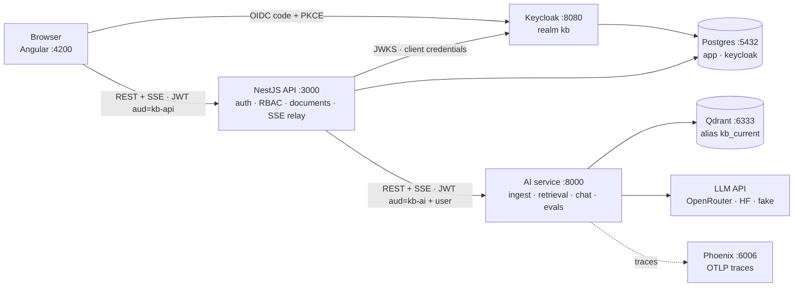
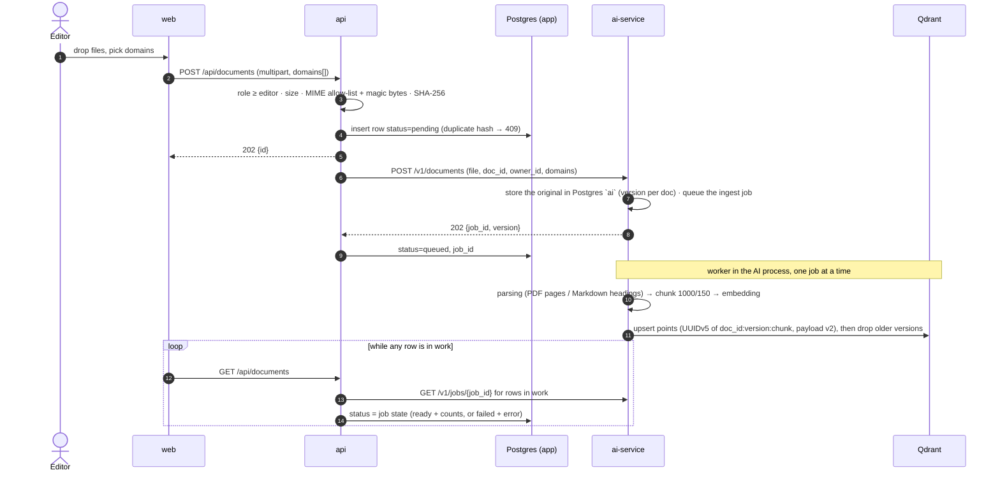

# Architecture (Phase 1)

How the pieces fit together and what happens on the two paths that matter: **ingest** and **chat**.
Decisions behind it: [plan.md §3](../plan.md#3-decisions) and the [ADRs](adr/README.md).

## Components



| Component | Owns | Never does |
|---|---|---|
| **web** (Angular, nginx in containers) | Login (keycloak-js, PKCE), documents, chat, retrieval inspector; runtime config from `/config.json` | Talk to the AI service, Qdrant or the LLM |
| **api** (NestJS) | Token validation (`aud=kb-api`), RBAC, document metadata in Postgres, upload checks, per-user chat throttle, SSE relay | AI logic: no parsing, embedding, prompting or LLM calls ([ADR-0002](adr/0002-ai-layer-in-python.md)) |
| **ai-service** (FastAPI) | Parse, chunk, embed (fastembed, in-process), Qdrant, prompt, LLM stream, citations, evals, tracing | Face the browser; it only accepts the API's service token (`aud=kb-ai`) |
| **Keycloak** | Users, realm roles `viewer` < `editor` < `admin`, clients `kb-web` / `kb-api` / `kb-ai` | — |
| **Postgres** | Databases `app` (documents) and `keycloak` | Store vectors or originals (not kept in Phase 1) |
| **Qdrant** | One collection per embedding model, alias `kb_current` | — |
| **Phoenix** | OTLP traces: `chat → embed → search → llm`, `ingest → parse → chunk → embed → upsert` | — |

Every request carries an `x-request-id` from the browser through the API to the AI service; both
backends log it in JSON.

## Ingest flow



- The queue (Procrastinate) lives in Postgres `ai`, so jobs survive restarts; a job whose worker died
  runs again (idempotent per document version). An API restart fails only rows the AI service never got.
- Delete cancels a queued job and removes the original and the points from every collection kept for a
  rollback (`DELETE /v1/documents/{doc_id}`); a running job answers 409.
- `pnpm kb:reindex` builds a new collection from the stored originals, runs the golden `dev` and `test`
  sets against it and the live one, and moves the alias `kb_current` only if no `test` metric drops by
  more than 0.02 (ADR-0015); `--rollback` points it back.

## Chat flow

```mermaid
sequenceDiagram
  autonumber
  actor U as User
  participant W as web
  participant A as api
  participant AI as ai-service
  participant Q as Qdrant
  participant L as LLM

  U->>W: question (+ optional domains)
  W->>A: POST /api/chat {messages, domains?} — fetch stream
  A->>A: role ≥ viewer · per-user throttle
  A->>AI: POST /v1/chat + service token + user {sub, roles}
  AI->>AI: embed query (dense + BM25)
  AI->>Q: dense top 50 + sparse top 50, domain filter, weighted RRF → top_k; dense scores of those hits
  AI->>AI: optional (RERANKER_MODEL): cross-encoder over the top 10 fused hits → top_k, its scores
  AI->>AI: best score < threshold → no sources (abstain)
  AI-->>A: event: sources
  A-->>W: event: sources (relayed unchanged)
  AI->>L: grounded prompt (rules, numbered untrusted sources, trimmed history)
  loop stream
    L-->>AI: delta
    AI-->>A: event: token
    A-->>W: event: token
  end
  AI-->>A: event: done {usage incl. cost, model, trace_id}
  A-->>W: event: done
  Note over W,L: Stop or a closed tab aborts the fetch → the API aborts upstream → the AI service cancels the LLM stream
```

- Events: `sources`, `token`, `done`, `error`; schemas in `packages/contracts` (D12, D14).
- The prompt tells the model to answer only from the sources, cite them as `[n]` and say "not in the
  knowledge base" otherwise; the UI turns `[n]` into chips that open the cited chunk.

## Runtime modes

| | Mode A — `pnpm stack:up` + `pnpm dev` | Mode B — `pnpm stack:up:full` |
|---|---|---|
| Infra (Postgres, Qdrant, Keycloak, Phoenix) | Compose | Compose |
| web · api · ai-service | native, hot reload | containers built from `apps/*/Dockerfile` |
| Use for | daily development | demos, e2e (`pnpm e2e`), image tests |

Ports are the same in both modes, so Keycloak's redirect URIs never change. Inside Compose the backends
reach Keycloak as `http://keycloak:8080` (`KEYCLOAK_REALM_URL`, `AI_KEYCLOAK_REALM_URL`) but still
validate `iss=http://localhost:8080/realms/kb`, the issuer the browser sees.
